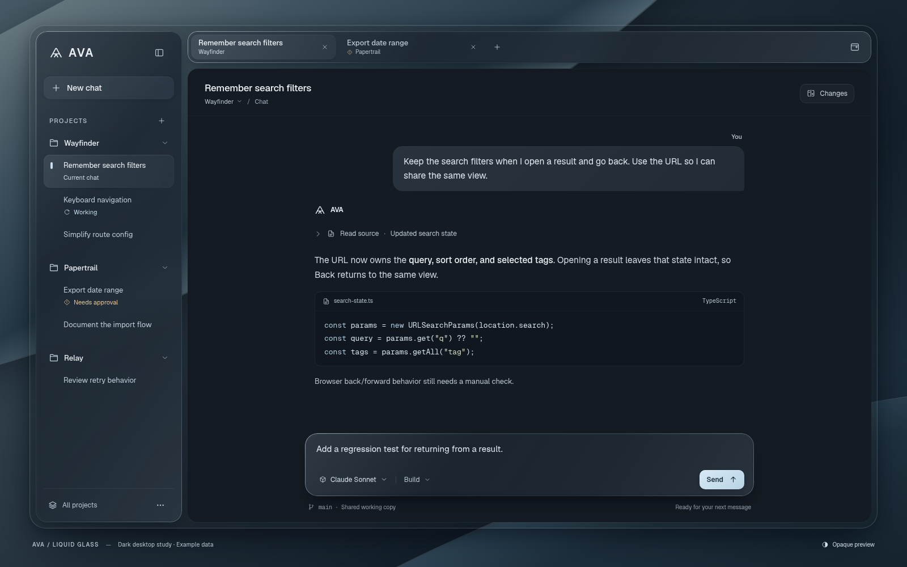

# AVA — dark liquid-glass study

**2026-10-04 historical study · Its material direction was initially approved.
Later feedback requests monochrome, sidebar-only navigation, and an inset composer
in the separate React prototype. Not full-client implementation.**

A fresh visual direction designed by **Astra at max reasoning**, not a revision
of the rejected SVGs. The standalone [HTML/CSS preview](concepts/liquid-glass/index.html)
was rendered and inspected in sandboxed system Chrome. The user approved the
visual direction, with two refinements requested:

- Make the top chat-tab bar smaller and simpler so it occupies less vertical space.
- Explore a more integrated, connected sidebar/shell instead of a raised,
  disconnected-panel appearance, while preserving the glass treatment.

The captures below show the approved direction **before those refinements**.
The successor is the separate [React UI prototype](react-prototype.md).
The user subsequently authorized a separate React/TypeScript UI-only port with
mock data, explicitly requesting **Astra at max reasoning** for code and design.
The first React-port request removed floating permanent surfaces: a compact tab
strip, sidebar joined to the shell, docked composer, and no background gaps
between regions. This original HTML and its captures remain unchanged as iteration
history. Subsequent feedback removes horizontal tabs and the full-width composer
stripe, adds optional sidebar Pinned/Recent shortcuts, removes developer-style
footer/helper rows, and requests neutral black/white/grays. The current
[React prototype](react-prototype.md), not these original blue-toned captures,
tracks that revision. Final refined layout, light design, backend integration,
and full-client implementation remain separate decisions.



| Rendering | Artifact |
| --- | --- |
| Dark, 1600×1000 | [Primary concept](concepts/liquid-glass/ava-liquid-glass-dark.png) |
| Dark, 1440×960 | [Standard desktop width](concepts/liquid-glass/ava-liquid-glass-1440.png) |
| Dark, 1180×900 | [Compact desktop width](concepts/liquid-glass/ava-liquid-glass-compact.png) |
| Opaque, 1440×960 | [Reduced-transparency preview](concepts/liquid-glass/ava-liquid-glass-opaque.png) |

## Historical design direction

**Smoked glass around a quiet reading surface.** Cool mineral tones, silver-blue
edge reflections, and restrained depth replace flat beige/charcoal panels.
The original CSS folded-light background is presentation staging, not a proposed
AVA wallpaper or copied reference asset.

- Three non-overlapping material surfaces: the full project/chat sidebar, the
  small chat working-set strip, and the floating composer. Directional one-pixel
  rims, inner highlights, tint, real `backdrop-filter`, and soft contact shadows
  provide depth. The shell itself has no blur. Nested buttons and selections use
  fills, **not additional glass**.
- Conversation content stays on opaque `#151b22`. Messages, inline code, and the
  short code excerpt have no backdrop blur. Change review starts **closed**;
  tool activity is a quiet, working disclosure rather than a wall of cards.
- Geist / Geist Mono are resolved from this machine, with system fallbacks.
  No fonts are bundled or adopted. Core navigation is approximately 13–14px;
  prose is 15–15.5px. Small secondary metadata is subordinate, not ultra-light.
  All small vector icons are original; no Apple typefaces or SF Symbols.
- A pale ice-blue Send action is the primary accent. Working and approval use
  distinct icons **and text**, with amber reserved for attention. No perpetual
  animation, neon glow, fake window traffic lights, metrics, editor, or terminal.

### Product shape recorded in the original artifact

This study followed the then-approved horizontal working-set proposal; current
[navigation direction](window-navigation-research.md#approved-navigation-direction)
now supersedes it with sidebar-only shortcuts. The approved
[library direction](library-research.md#approved-library-direction) is unchanged.
This artifact imports none of those libraries and adopts no versions.

The complete sidebar contains three projects and their chats. Only two
**user-chosen chats**, from different projects, appear in the working set; the
background Working chat is intentionally **not** a tab. The current chat is
idle, with a draft and **Send**, not a misleading simultaneous Stop action.
A real running-chat view would require explicit Stop. Switching views or closing
a tab must not cancel, delete, archive, or duplicate a run. The window affordance
only illustrates the approved optional additional window; close/quit semantics
remain undecided.

The footer identifies a shared `main` working copy. Worktrees remain **off by
default**, require explicit opt-in, and are not a security/isolation guarantee.
Workspace/model selectors are visible affordances, not implementations.
Permission decisions, backend admission/routing, and run ownership are not
invented here. No safety toggles or permission shortcuts were added.

**Everything in the app frame is invented fixture content**: project/chat names,
statuses, branch, draft, activity, filenames, code, and conversation. No actual
files were changed by the depicted agent; no tests, usage figures, private
transcripts, IDs, or authentication data are represented. “Claude Sonnet” is an
illustrative label, not an availability promise.

Only the tool disclosure, editable draft, and external **Opaque preview** switch
are interactive. Other buttons report outside the app that they are unconnected.
There is no routing, persistence, message submission, provider, or backend.

## Research applied

Primary-source research supplied for this task was retrieved **2026-10-04**;
this pass visually inspected the captures below rather than repeating a broad
market survey.

| Principle | Primary guidance and interpretation |
| --- | --- |
| Controls float; content stays clear | [HIG materials](https://developer.apple.com/design/human-interface-guidelines/materials): glass belongs to navigation/controls, not content. Text-heavy chrome uses one regular-inspired treatment, not clear glass over prose. |
| Avoid glass on glass | [WWDC25: Meet Liquid Glass](https://developer.apple.com/videos/play/wwdc2025/219/): shared material planes; ordinary fills for nested controls. |
| Hierarchy through restraint | [Layout](https://developer.apple.com/design/human-interface-guidelines/layout), [typography](https://developer.apple.com/design/human-interface-guidelines/typography), and [color](https://developer.apple.com/design/human-interface-guidelines/color): progressive disclosure, spacing, readable weights, limited tint, and a small scroll-edge fade above the composer. |
| Adapt explicitly | [Accessibility](https://developer.apple.com/design/human-interface-guidelines/accessibility) and [adopting Liquid Glass](https://developer.apple.com/documentation/technologyoverviews/adopting-liquid-glass): custom CSS does not inherit native adaptation. The preview includes focus-visible rules, an opaque switch, and reduced-motion / increased-contrast rules. |
| Browser approximation, not native optics | [MDN backdrop-filter](https://developer.mozilla.org/en-US/docs/Web/CSS/backdrop-filter) and [web.dev](https://web.dev/articles/backdrop-filter): blur/tint and stacking need browser validation; rendering cost is unmeasured. An `@supports` opaque fallback is provided, without shaders, polyfills, or libraries. [Reduced transparency](https://developer.mozilla.org/en-US/docs/Web/CSS/@media/prefers-reduced-transparency) remains experimental, so that media rule is not a universal OS mapping promise. |

### References actually inspected visually

All seven local images were read as images before designing. The research
captures remain gitignored and are **not copied, embedded, or bundled** here.
Official screenshots and independent concepts are inspiration, not proof of
accessibility, performance, or equivalent shipped features. No competitor was
installed or run.

| Reference | Type and specific lesson |
| --- | --- |
| Zeron `app-screenshot.jpg`, pinned at `1c83cda221bd18a3b55ea49e5b25ec2c148955bc` ([source location](https://github.com/zeronsh/zeron/blob/1c83cda221bd18a3b55ea49e5b25ec2c148955bc/apps/landing/public/assets/app-screenshot.jpg)) | Published app screenshot: quiet chrome, readable conversation, grouped tool rows, small composer. Its open changes pane and purple wallpaper are **not** carried forward. No source/backend adoption. |
| `craft-desktop.png` — [Craft](https://www.craft.do/) | Current official site screenshot: sculpted sidebar rim and measured row rhythm, not its document grid, emojis, or editor architecture. |
| `apple-safari.jpg` — [macOS Tahoe announcement](https://www.apple.com/newsroom/2025/06/macos-tahoe-26-makes-the-mac-more-capable-productive-and-intelligent-than-ever/) | Official screenshot, **June 9, 2025**: glass controls above crisp content; restrained grouping. No Safari clone or native/macOS support claim. |
| `apple-icon-composer.jpg` — [Apple design announcement](https://www.apple.com/newsroom/2025/06/apple-introduces-a-delightful-and-elegant-new-software-design/) | Official screenshot, **June 9, 2025**: sidebar contours and material depth, not its giant icon, wallpaper, or window controls. |
| `glass-chat-concept.jpg` — [ChatGPT Liquid Glass](https://dribbble.com/shots/26332569-ChatGPT-Liquid-Glass), retrieved via [curated gallery](https://liquidglassdesign.com/gallery/chatgpt-liquid-glass) | Independent concept: delicate reflected composer rim. Its low-contrast placeholder is explicitly **not** a target or usability guarantee. |
| `glass-tab-concept.jpg` — “Liquid Glass Tab Bar UI by Shamnad,” via its [curated page](https://liquidglassdesign.com/gallery/liquid-glass-tab-bar-ui) | Independent concept: smoked material and directional edge light, not audio features or mobile proportions. |
| `raycast-notes.png` — [Raycast Notes](https://www.raycast.com/blog/raycast-notes) | Older official dark utility screenshot: restrained density and contour. Not evidence of Liquid Glass adoption. |

## Checks actually run

**Actually checked:**

- Read all seven reference images; confirmed installed Geist and Geist Mono with
  `fc-list`. The preview bundles or loads no external assets, font files, or
  dependencies. Reference captures remain ignored research inputs.
- Managed Chrome for Testing **151.0.7922.34** failed with `No usable sandbox!`;
  the quick doctor check had not exercised sandbox launch. Selecting the existing
  `/usr/bin/google-chrome-stable` through `--executable-path` resolved preview
  rendering without installs, security changes, bypass flags, or profile/auth
  reuse. System Chrome **153.0.8010.36** reported namespace, PID/network namespace,
  and seccomp-BPF sandboxes enabled, and “You are adequately sandboxed.” Only
  dedicated preview sessions were used; `t3research` was left untouched.
- Browser captures at **1600×1000, 1440×960, and 1180×900**; no horizontal page
  overflow or sampled controls outside the viewport. The compact and opaque
  captures supplement the primary concept. CSS `backdrop-filter` is supported
  and computed as `blur(28px) saturate(1.12)` on the three material surfaces.
- Tab from New chat reached Open a project with a visible 2px focus outline;
  keyboard Enter opened and closed tool disclosure. The Opaque preview switch
  changed the computed material to `#293642` with `backdrop-filter: none`.
  Changes and tool details started closed. No page errors or external HTTP(S)
  requests were observed; sandbox diagnostics loaded only internal Chrome URLs.
- Finite rendered-surface check at **1440×960**: **69 visible text ranges**,
  minimum **5.43:1**, none below 4.5:1. Computed solid foreground colors were
  compared against background pixels across each range, with text/icon colors
  temporarily hidden, transitions disabled, and two paint frames awaited.
  Antialiasing, every state/background, and full accessibility are not certified.
- Python's HTML parser: 20 unique IDs and 31 resolved internal SVG references;
  explicit button types and decorative SVG labels; no external resource
  declarations, CSS imports, or network API calls. Preview JavaScript passed
  `node --check`. CSS braces balanced; no CSS parser was installed. New Markdown
  relative links/anchors and both new files’ whitespace passed; `git diff --check`
  was clean.
- Finite **token/alpha contrast estimates**, not browser pixel samples: prose on
  the opaque canvas **12.28:1**; user text **10.31:1**; secondary text/icons on a
  conservative glass estimate **5.04:1**; selected-row label **4.89:1**;
  Working **6.11:1**; approval **5.18:1**; Send text/icon **9.36:1**;
  secondary text in opaque mode **7.17:1**. Glass was estimated by compositing
  `#1d2732` at 80% over `#7d8b92`, then the 10% `#dcecf7` highlight; selection
  additionally used `#d4e7f5` at 27/255. These bounded checks guided stronger
  text colors but do not establish actual composited contrast everywhere.

**Still required before implementation:** approval of the refined layout and
implementation scope; full keyboard
and screen-reader coverage; OS accessibility-preference and unsupported-blur
fallback verification; other content/background states; production Electron
CSP/sandbox and GPU/scroll performance. No WCAG certification, native glass API,
backend/provider run, or Electron runtime test is claimed. Light theme is not
designed here. Browser preview checks do not qualify the existing Electron client
or resolve its separate Ubuntu sandbox-helper prerequisite.

### Reproduce the browser preview

Open the HTML directly in a local browser, or from the repository root use these
capture commands. On this machine, the existing system Chrome works while the
managed Chrome does not; use a properly sandboxed installed browser. No server
or npm install is required. Never add `--no-sandbox` or disable security guards;
if launch is blocked on another host, stop and report it.

```sh
agent-browser skills get core
agent-browser --session ava-glass-design --executable-path /usr/bin/google-chrome-stable open "file://${PWD}/docs/desktop/concepts/liquid-glass/index.html"
agent-browser --session ava-glass-design set viewport 1600 1000
agent-browser --session ava-glass-design screenshot docs/desktop/concepts/liquid-glass/ava-liquid-glass-dark.png
agent-browser --session ava-glass-design set viewport 1440 960
agent-browser --session ava-glass-design screenshot docs/desktop/concepts/liquid-glass/ava-liquid-glass-1440.png
agent-browser --session ava-glass-design snapshot -i
agent-browser --session ava-glass-design set viewport 1180 900
agent-browser --session ava-glass-design screenshot docs/desktop/concepts/liquid-glass/ava-liquid-glass-compact.png
agent-browser --session ava-glass-design set viewport 1440 960
agent-browser --session ava-glass-design click .material-switch
agent-browser --session ava-glass-design screenshot docs/desktop/concepts/liquid-glass/ava-liquid-glass-opaque.png
agent-browser --session ava-glass-design errors
agent-browser --session ava-glass-design network requests
agent-browser --session ava-glass-design close
```

The PNGs above are existing browser captures, not substitute SVG renders.
Reproduction captures should still be visually inspected; successful export
alone does not establish design quality or approve implementation.
