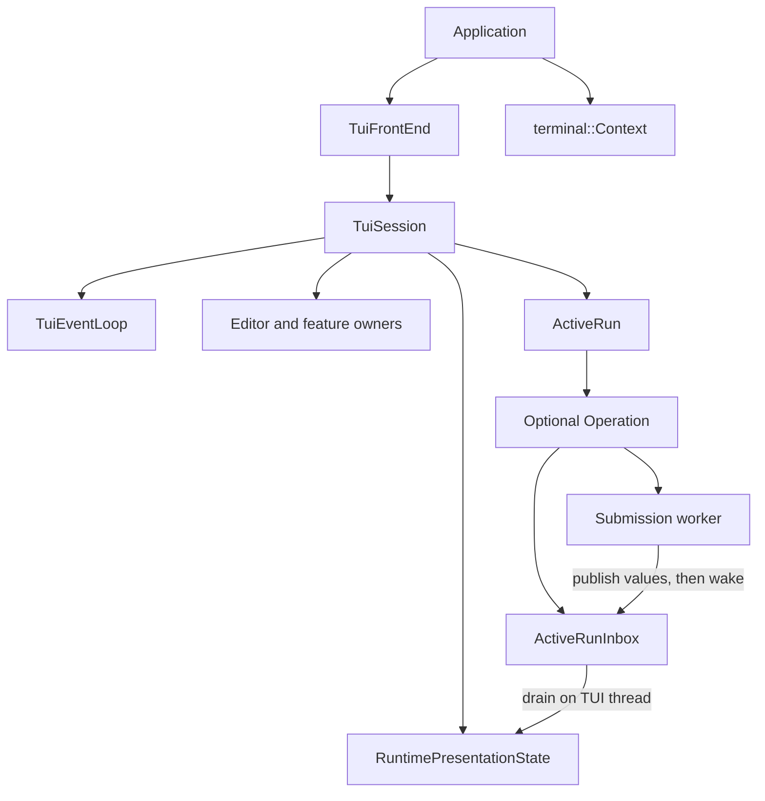

# TUI architecture

This guide describes the current ownership and control flow of the terminal UI
under `src/ava/tui/`. Use it when changing TUI internals. The
[application architecture](../development/architecture.md) explains the backend
that the TUI calls. The [C++ safety rules](../development/cpp-safety-rules.md)
still apply to every change.

## Start here

Read [TuiSession.h](../../src/ava/tui/TuiSession.h) for ownership, then
`TuiSession::run` in [TuiSession.cpp](../../src/ava/tui/TuiSession.cpp) for the loop.
Read [TuiEventLoop.h](../../src/ava/tui/TuiEventLoop.h) next for waiting and timer
lifetimes.
These files coordinate work. Keep feature algorithms in the owners listed below.

For a submitted message, follow `RuntimeSubmitController::submit`,
`ActiveRun::start`, `ActiveRunInbox`, and `ActiveRun::complete`. For a key,
follow `runtime_input::poll_curses_input`, the dispatch order in the session
constructor, and the first handler that consumes the key. Active submissions use
`ActiveRunInput` for ordinary keys.

## Glossary

Prefer the concrete object or operation in comments. These terms still appear in
some APIs and explain the boundaries between features:

| Term | Meaning here |
| --- | --- |
| Authority | The component or data that decides a particular operation. For example, backend validation decides whether a session can open; the renderer's supplied layout maps a mouse click to a transcript item. That layout may be prepared before the next paint. A display view alone does not grant backend access. |
| Receipt | A request ID returned in `TuiSubmitResult::ordinary_turn_request_ids` to confirm a real model turn. For a slash command, an event enters the conversation only when its nonempty request ID exactly matches one of those IDs. |
| Admission | Whether a named queue or input route currently accepts new work. Closing a queue, stopping key handling, and requesting worker cancellation are separate actions. |
| Claim | The TUI coordinator's hold on a pending prompt request. The worker stays blocked until an answer exists and the hold is released, after callbacks borrowing worker data are removed. |
| Projection | Data prepared for display. A const display view is borrowed on the TUI thread; it is not a synchronized snapshot for workers. |
| Publication | Storing data so its consumer can read it. A producer stores a queued event before notifying the loop. Updating display data does not mean a frame has been painted. |
| Settle | Apply a finished operation's result and run its completion cleanup. Comments should name those steps when their order matters. |
| Chrome | Decorations around the content, such as the scroll position and new-output count. Comments should name the particular decoration. |
| Final result | The submission worker's returned `TuiSubmitResult` or captured exception, carried by `ActiveRunResult`. The separate `ActiveRunOutcome` tells the session whether to continue or exit. “Terminal” elsewhere means the user's TTY. |

## Ownership and destruction

The application owns the concrete `TuiFrontEnd` and `terminal::Context`.
`TuiFrontEnd::run` initializes terminal presentation, installs its existing
signal policy, performs the startup background-color probe, and constructs a
`TuiSession`. The frontend and context outlive that session.

Five features borrow small interfaces implemented by the same frontend. Their
backend-action declarations remain protected on `TuiFrontEnd`; virtual calls
through the feature interface reach the existing application validation.

| Feature | Frontend interface |
| --- | --- |
| `TuiSession` | [TuiSessionActions](../../src/ava/tui/TuiSessionActions.h): mode, committed identity, diagram callbacks and bindings. |
| `SettingsDialog` | [SettingsDialogActions](../../src/ava/tui/SettingsDialogActions.h): Settings actions, trust, bindings and copied model labels. |
| `SessionSelector` | [SessionSelectorActions](../../src/ava/tui/SessionSelectorActions.h): session catalogs, archive and open actions. |
| `BranchSummaryOperation` | [BranchSummaryActions](../../src/ava/tui/BranchSummaryActions.h): summary snapshots, generation-checked commands and bindings. |
| `SelectorInputController` | [SelectorInputActions](../../src/ava/tui/SelectorInputActions.h): model and user-turn choices, plus bindings. |

These interfaces make feature dependencies explicit. A deliberate public-base
cast remains possible; the interfaces do not replace backend validation.
`TuiSession` accepts the full frontend only to construct its collaborators, then
retains its narrow interface. The presentation owner keeps its own frontend and
uses it for coordinated display updates. Apply a new binding map through
`RuntimePresentationState::apply_local_key_bindings` so dispatch and displayed
hints agree. The frontend replaces the map's value while preserving the object
address borrowed by existing features.

The session constructs its members in dependency order. A feature's borrowed
references point to earlier members. C++ destroys members in reverse order,
so timer handles, input callbacks and features disappear before the objects
they borrow. Do not reorder those declarations without checking every borrow.
Neither the session nor a registered callback target may move.

Composer edits establish a valid cursor before returning. `project()` only copies
editor fields into the screen. `RuntimeActionController::clear_draft_for_interrupt()`
publishes the full edit before its caller decides what to do next. Run display
updates use separate operations for a frame, live progress and a final summary.
An empty live update clears current activity and todos; an omitted final summary
preserves those facts. Neither updates the detached sidebar until its viewport
owner prepares a frame.

| Owner | Responsibility and owned state |
| --- | --- |
| `TuiSession` | Composition, loop order, control decisions and transitions between owners. |
| `TuiEventLoop` | Timer registrations and a shared `TuiWaitState` for OS waiting. It does not own feature state or decode keys. |
| `RuntimePresentationState` | The screen and sidebar projections. Readers get const views; features publish through named operations that preserve bounds and generations. |
| `Composer` | Draft, cursor, selection, editing history, completion choices and Escape state. |
| `RuntimeRenderer` | Frame scheduling, completion/layout caches and `TranscriptView`. It prepares layout around viewport changes. |
| `TranscriptView` | Live versus detached scrolling, frozen sidebar, selection, deferred updates and position indicator. |
| `SelectorHost` | The one visible selector projection and its kind. Settings, session and generic selector owners decide its behavior. |
| `RuntimePromptCoordinator` | Permission/question queues, the single active claim, modal input callbacks and automatic-answer timers. |
| `RuntimePluginUiCoordinator` | A private synchronized transport for plugin requests and the current submission's UI binding. |
| `ActiveRun` | One optional `Operation`: inbox, reducer, worker future, backend queue capabilities and completion flags. |
| `ActiveRunInput` | Ordered ordinary input policy while a run is active. It requests queue operations without borrowing mutable queue storage. |
| `BranchSummaryOperation` | TUI presentation and discovery of an application-owned summary operation. |
| `RuntimeMermaidPresentationController` | Diagram readiness, retry timing and transcript projection; the application owns rendering workers. |
| `PendingAttachments` | Staged attachment references and their visible badges until submission takes or clears them. |

Normal exit cancels the control timer, shuts down the active run, stops
Mermaid/plugin/prompt requests and invokes the frontend shutdown hook while
the terminal is still available. The session destructor also covers early
returns and exceptions. Active-run cleanup releases waiting prompts and plugin
requests before joining its worker. Joining before releasing those waits can
deadlock. If any release step throws, shutdown logs only the failed stage, records
the failure and terminates instead of joining a worker that may never return.
Failures after the join produce a nonzero session outcome. The frontend's outer
shutdown guard covers exits that never reach
the session's normal exit path.

Selector input returns an owned `SelectorDispatchResult` variant. Each
alternative carries only its needed fields; a parent summary always carries the
view it will restore. `TuiSession::handle_selector_input` applies that result
after selector cleanup and before requesting paint. Session success and error
both reconcile the backend's committed identity before displaying feedback.

`RuntimeRenderer` and `RuntimePluginUiCoordinator` require the session's event
loop in their constructors. Their timer registrations are ready before input or
worker endpoints can use them. Tests also supply a real loop, whose pipe and
registry outlive the feature. `render()` requests a batch paint;
`paint_ready_frame()` performs eligible work, and `paint_for_handoff()` supplies
synchronous output when a prompt or terminal handoff requires it. Plugin expiry
comes from its timer; polling only consumes the resulting transport updates.

Pointer navigation returns owned editor feedback to `TuiSession`. A clicked
completion row consumes the pointer event even when that row cannot insert text;
the event does not start a transcript selection underneath the palette.

Tests inspect public screen publications and editing behavior. Tests that need
to prove a prompt was painted use a scoped observer of real drawing, without
servicing pending frames during observation. Keep that distinction when changing
tests for prompts or frame order.

## Debug output

Print TUI owners on the TUI thread. Generated printers show reference and raw
pointer members as addresses; they do not inspect the borrowed objects.
For its operation, `ActiveRun` prints only the lifecycle flags. Plugin transport stays
opaque, so logging does not read its synchronized request queue.

Use the explicit `NoLogString` annotation for owned strings that can contain
prompts, paths or other user text. The generator omits the whole annotated
member, including optional or container forms. A new alias that hides that
spelling needs its own generator support; ordinary `std::string` still prints.
The [debug privacy tests](../../tests/debug_pointer_security_tests.cpp) protect
this distinction. A debug marker alone does not sanitize content.

## One turn of the loop

The normal order in `TuiSession::run` is:

1. **Control.** Observe signals, terminal closure, descriptor errors and recorded
   rendering or notification failures. Cancellation may release a waiting worker.
2. **Due timers.** Dispatch the registrations whose deadlines were due at the
   start of this pass. Timer callbacks update their feature or request a frame.
3. **Application updates.** Consume up to 256 active-run events, handle completion,
   and update feature presentation. An open host prompt holds provider events,
   Mermaid completions and display-settings reloads until the prompt retires.
   Their pending work stays queued. Workspace discovery still runs here while a
   host prompt is open; it requests a frame only when its view changes. A failed
   frame request still stops the loop.
4. **Input.** Poll up to 32 input results. A discarded control reply consumed input
   and counts toward that budget; it does not mean the input buffer is empty.
   Check signals again after decoding before dispatching a retained key.
5. **Paint.** Paint a ready frame. The renderer checks the clock here, so a frame
   deadline crossed during input decoding can be honored in this turn.
6. **Wait.** Use `ReadyOnly` when another turn has runnable work, including a full
   input batch. Otherwise use `Block` until input, a producer notification or the
   earliest timer deadline. Waiting does not read terminal input or run callbacks.

There is no second timer/application pass after painting. A timer that becomes
due during input or paint gets a new turn beginning with control. Scheduled
frames normally use a 16 ms interval from the previous completed paint;
explicit urgent redraws and terminal handoffs have their own immediate paths.

Two exceptions are deliberate. After hangup or descriptor error, the session
stops admission and drains the finite buffered input without dispatching it,
painting or waiting on the permanently ready descriptor. After a worker
publishes completion, `complete()` joins it and freezes further publication,
then drains the finite final backlog in chunks of at most 256 events and settles
in that same call. A large final backlog can therefore lengthen that turn.

The control timer is a plain wake-up every 100 ms. Its callback does not claim
signals or perform cancellation. This is a nominal observation cadence, not a
100 ms response guarantee: synchronous callbacks and long turns can delay the
next control stage. The underlying waiter retries interrupted system calls.
Escape decoding has a separate default of 100 ms in `config.h`; ncurses uses
`ESCDELAY` when configured. Neither mechanism promises a 50 ms Escape response.
Native reads have their own timeout: Escape continuation uses 100 ms and paste
continuation uses one second. Those are per-read timeout settings, not a bound
for decoding an entire input sequence or for completing the startup probe.
ncurses' own Escape handling can add delay to a continuation read.

## Threads and publication

The TUI thread owns ncurses, input decoding, presentation, editing, layouts,
selectors and feature timer callbacks. Const screen views are ordinary borrowed
references, not snapshots that a worker may read concurrently. Named publication
operations do not make presentation state thread safe.

The submission worker calls the frontend with request-local context. It may
publish runtime events, request a permission or answer, or call a plugin UI
endpoint. Other backend threads can retain those endpoints too. They transfer
owning values through synchronized inboxes or pending requests. They never touch
ncurses or mutate the screen. Application-owned Mermaid workers publish render
completions; branch-summary work also remains application-owned.

A producer publishes its payload **before** calling `TuiWakeup::notify`.
Notifications carry no payload and may coalesce. A failed notification records
a failure for control to observe; recording that flag does not itself wake an
already blocked waiter. The control timer gives it another observation opportunity. The TUI must re-examine the
mailboxes each turn rather than treat a notification count as an event count.
`ActiveRunInbox` protects its queue, captured request context and final result
with one mutex. Its `RuntimeEventQueue` member is only FIFO storage and has no
independent lock. FIFO means first in, first out: draining preserves publication
order within the queue.

`TuiWakeup` holds a weak pointer to the OS wait resources. Locking it briefly
keeps those resources alive during notification, possibly after `TuiEventLoop`
has released its own share. The last producer pin may destroy them. This does
not join a producer or protect any other object it uses. Owners must still stop
and join workers before destroying their dependencies. A copied Mermaid callback
can likewise run after it is unregistered; it retains shared readiness state and
a weak wake handle, not a pointer to the presentation controller.

Mermaid producers retain a shared copy of the registered callback while holding
the queue mutex, then invoke it after releasing that mutex. The application
bridge also releases its mutex before any operation that can notify or join.
A callback can therefore query or drain results. Callbacks may overlap and must
protect their own mutable state. They must not destroy the coordinator or join
its worker from a worker callback. Result drainage reserves space for the bounded
batch before taking it; allocation failure requests a retry without losing results.

## Queue and buffer limits

These are local implementation limits, not a bound on all TUI memory. The
refactor keeps the baseline capacities. In particular, bounded work per turn
does not imply bounded queue storage.

| Owner or buffer | Current bound |
| --- | --- |
| `ActiveRunInbox` event FIFO | No local item or byte cap, as in the baseline. Live turns drain at most 256 events; that is a fairness limit. The final result occupies one separate slot. |
| Permission and question request queues | No local queue cap, as in the baseline. Each producer blocks on its request, but upstream concurrency is not a local capacity guarantee. |
| Plugin UI ordinary records | 63 queued records. A detached batch can hold another 63 while producers refill; this is not a global 64-record limit. There is one interactive modal reservation, an 8-KiB validated text budget per request, at most 32 widget lines, and four displayed widgets. |
| Mermaid coordinator | 32 undrained request identities across queued, active, and completed work. Source is at most 64 KiB; accepted output is at most 256 KiB per result. Cache limits are 128 sources and 4 MiB of accepted output. A detached drain batch is additional temporary storage. |
| Mermaid TUI presentation | 128 retained records and 4 MiB of accepted output; at most 32 pending backend requests. Candidate scanning can temporarily examine the full transcript, so retained-record limits are not peak-allocation limits. |
| Startup input replay | 64 decoded events. A paste has at most 1 MiB of text, stored in both the full event and its key-event view. The internal enqueue helper has no independent byte cap; production decoding supplies the size limit. |
| Paste and escape decoding | 1 MiB of retained paste text and 16 KiB per escape sequence. A truncated paste tail retains only a flag and a closing-marker position, and is discarded through normal polling. |
| Native input and keyboard negotiation | A raw read is at most 4096 bytes. Startup keyboard negotiation has two 50-ms collection phases but no total byte cap, unchanged from the baseline. ncurses and the kernel own their own buffers. |
| One input turn | At most 32 decoded or discarded results. Escape/paste continuation can perform multiple native reads within one result. |

The limits live in [input decoding](../../src/ava/tui/runtime_input.cpp),
[plugin UI transport](../../src/ava/tui/runtime_plugin_ui_internal.cpp), and
the [Mermaid coordinator](../../src/ava/app/mermaid_render_coordinator.h).
Adding hard limits to the event or prompt queues would need an explicit overflow
policy; silently dropping tool results or permission requests is not acceptable.

## Submission, prompt and plugin flows

`RuntimeSubmitController` validates the draft and completion choice, performs
recognized local commands, records submitted history and starts `ActiveRun`.
The operation creates its inbox and backend queue capabilities, opens prompt and
plugin admission, and launches the worker. `ActiveRunEvents` reduces received
values on the TUI thread. For slash commands, an event may enter the conversation only when its request
ID matches a backend-returned `ordinary_turn_request_ids` entry. Other command
output stays outside that transcript.

The worker publishes exactly one final result after its backend callback
scopes have ended. Taking that result does not permit a second publication:
the inbox retains a consumed state. Completion retires worker-borrowing prompt
callbacks, joins the worker, authorizes receipts, applies any committed session
transition and finishes backend queues. Queue finishing can publish final
receipts, so inbox admission closes afterward. Old-session events are discarded
only after that closure. Final draining and settlement then retire the operation.

A permission or question request owns its prompt and a prebuilt interruption
result in `PendingRequest`. The worker waits for a result and for release of any
UI claim. The coordinator moves one queued request into its sole active claim,
prepares or automatically resolves it, and routes input while it is visible.
The UI must retire callbacks that borrow the prompt before releasing the claim.
Permission Escape is special: publish run stop first, then cancel the active
claim. A failed deferred paint completes the active prompt with an I/O error
before generic shutdown can answer it as interrupted.

Question prompts may contain a callable that checks for an automatic answer.
Copying or destroying that callable can run arbitrary code. The coordinator
therefore constructs question requests outside its queue mutex, then checks
again whether shutdown has closed the queue before inserting them. Cancellation
interrupts all queued waiters before releasing request ownership outside the
lock. Queue removal itself remains locked. Once closed, the queue refuses new UI claims, including calls made
from a retiring callback. Audit endpoints follow the same rule: retain shared
ownership under the audit mutex, then copy, invoke and destroy the callable
without the mutex. Each audit event uses a fresh callable copy.

Opening a host prompt and delivering its answer are synchronous rendering
handoffs. Queuing a frame is not proof that a choice was displayed successfully.
After opening, the coordinator discards input until the session decoder reports
empty, then flushes native and replay input. This prevents buffered keys from
answering a prompt they preceded. The flush also covers decoding errors, which
ncurses reports like empty input. Failure cancels the request with an I/O error.

Pasted text cannot invoke permission or question shortcuts. Only explicit text
fields accept it. A paste that reaches its one-MiB limit or times out still owns
later bytes: polling discards that tail until its closing marker arrives. Each
discarded character counts toward the usual 32-item input budget. A prompt flush
does not reset incomplete-paste tracking; only an actual terminal-session boundary
does. Permission resolution checks cancellation again after painting, before
releasing its worker. An already available automatic question answer retains its
existing precedence over ordinary cancellation.

Plugin endpoints hold weak references to private synchronized transport state.
Requests retain their submission binding and deadline. The TUI polls and
publishes them only when host modal policy permits. A host permission/question
keeps a plugin request queued until the prompt retires. Timeout, cancellation
and submission completion release waiting callers without requiring an allocated
"clear" record. Backend authority remains with the application; a displayed
plugin dialog does not grant access to mutable session or permission state.

## Adding a key, selector or timer

### Add a configurable key binding

1. Add the action and its binding storage in
   [keybindings.h](../../src/ava/tui/keybindings.h). In
   [keybindings.cpp](../../src/ava/tui/keybindings.cpp), update `kActions`,
   `keys_for_action`, `config_action_id`, `default_key_bindings`, `action_for_key`,
   `action_name`, `action_label` and `action_description` as needed. These keep
   configuration, defaults and help text consistent.
2. Implement the behavior in the feature that owns the state. Editing belongs in
   [Composer](../../src/ava/tui/Composer.h). For an ordinary editing action, add it
   to the ordered table in `Composer::handle_edit_actions` in
   [Composer.cpp](../../src/ava/tui/Composer.cpp) and implement its reset behavior
   in `Composer::apply_edit`. For another editor interaction, use the appropriate
   private phase method called by `Composer::handle_key`. Return a typed request
   for work owned elsewhere, such as submission or transcript copying.
3. Place the handler at its intended precedence in `TuiSession::input_dispatcher_`
   in the [session constructor](../../src/ava/tui/TuiSession.cpp). If the binding
   is available during submission, also place it in `ActiveRunInput::dispatcher_`
   in [ActiveRunInput.cpp](../../src/ava/tui/ActiveRunInput.cpp). Both dispatchers
   call Composer's phase policy; do not add a second editor action table in active
   input. Active cancellation, queue submission and local commands stay in
   `ActiveRunInput`. Earlier handlers win when configured keys overlap. Host
   modals capture keys first; Submit must remain ahead of ordinary Space insertion.
4. Extend [keybinding tests](../../tests/tui_keybinding_tests.cpp) for parsing and
   defaults, and [composer dispatch tests](../../tests/tui_composer_dispatch_tests.cpp)
   for editing and collisions. Add idle/active differences to the
   [shared policy tests](../../tests/tui_composer_policy_tests.cpp).
    Check both idle and active-run handling where the binding is supported.

### Add a selector or modal

1. Give a selector its kind in `ActiveSelectList` in
   [runtime_state_internal.h](../../src/ava/tui/runtime_state_internal.h).
   Put its state and behavior in a feature owner, rather than adding state to
   the session. For a non-selector modal, follow the corresponding prompt or
   plugin owner instead of adding an unused selector kind.
2. Use `SelectorHost::open`, `replace` and `close` to manage the visible
   `SelectListView`. The host publishes it through `RuntimePresentationState`.
   Specify which existing modal wins and whether typing passes through. Restore
   previews before another feature opens a competing view.
3. Add the selector branch in
   [SelectorHost::dispatch](../../src/ava/tui/SelectorHost.cpp). Return a typed
   result when another feature must act, and handle it in
   `TuiSession::handle_selector_input`. For an earlier capturing modal, add its
   handler to the session and active-run dispatcher lists where it is supported.
   A selector is not automatically available during submission.
4. Test opening, cancellation, preview restoration and overlapping input in
   [feature-owner tests](../../tests/tui_feature_owner_tests.cpp) or the relevant
   [composer rendering case](../../tests/tui_composer_rendering_tests.cpp).
   A blocking worker request also needs cancellation and shutdown tests proving
   that borrowed callbacks are removed before its worker is released. Keep all
   backend validation in the existing frontend/application operation.

### Add a timer

1. Let the feature own a `TuiTimer`. Construct the loop before that feature;
   declare the handle after the state its callback uses. Register with
   `loop.member_timer(*this, &Owner::callback)` at a stable object address.
   Registration does not invoke the callback.
2. Use `arm_at` for an absolute one-shot deadline or `repeat` for a positive
   interval. In the callback, mark work due or request a frame, then return.
   For work that calls the frontend or other features, add a service method and
   call it from `TuiSession::service_presentations` or the appropriate existing
   application-update owner. See
   [BranchSummaryOperation](../../src/ava/tui/BranchSummaryOperation.cpp).
3. Cancel before callback dependencies are destroyed. `cancel()` disarms the
   timer; destroying the handle removes its registration. Neither joins a worker.
   The target must stay alive until any callback already running has returned.
4. Extend [event-loop tests](../../tests/tui_event_loop_tests.cpp) for scheduling
   rules, or feature tests for the work it triggers. Use supplied clock values
   to check deadlines rather than relying on how quickly the test machine runs.

Timer dispatch copies registration IDs and generations before invoking callbacks.
A callback can rearm, cancel or remove registrations; stale entries from that
pass are skipped. Repeating timers skip missed ticks rather than replay a burst.
Do not decode input, paint, handle signals, recursively service timers or wait
inside a callback.

## Validation and limits

Use the development build and a UTF-8 locale. Focused tests such as
`ava_tests.tui_event_loop`, `ava_tests.tui_pending_requests`,
`ava_tests.plugin_ui`, `ava_tests.tui_composer` and the isolated
`ava_tests.tui_composer_rendering.*` cases cover different parts of the mechanism.
The isolated `ava_tests.tui_session.*` cases drive the real session with native
buffered input, worker queues and test-only call-through linker wrappers. They
check turn order, budgets, closure, signals and scoped I/O failures. The tmux
scenarios check whole terminal interactions. A scheduler unit test alone
does not prove the ordering in `TuiSession::run`, and compiling does not prove
cancellation or lifetime behavior.

Record the build and behavioral checks run for each change. When changing an
invariant, update its local comments and the test that exercises the observable
behavior. Keep this guide synchronized when ownership or loop order
changes; developers should not need the historical refactor plan to understand
the implementation.
