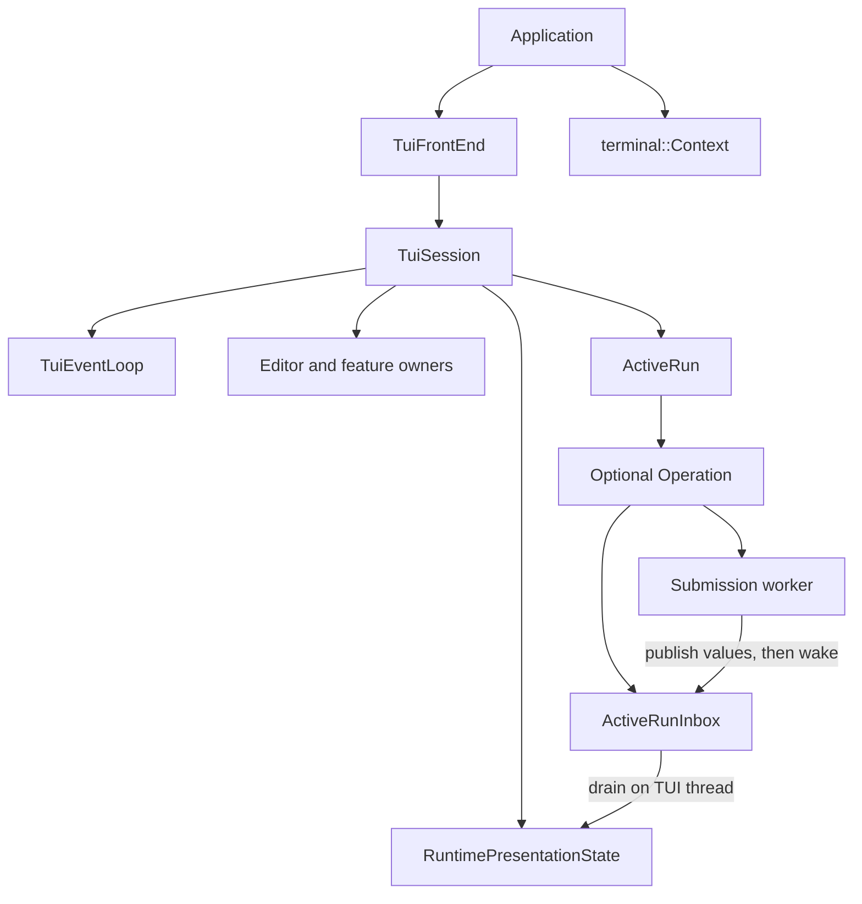

# TUI architecture

This is the implementation guide for the terminal UI refactor in issue #93.
It describes the current ownership and control flow under `src/ava/tui/`.
It is a guide for changing the code, not a new compatibility contract. The
[application architecture](../development/architecture.md) explains the backend
that the TUI calls. The [C++ safety rules](../development/cpp-safety-rules.md)
still apply to every change.

## Start here

Read `TuiSession.h` for ownership, then `TuiSession::run` in `TuiSession.cpp`
for the loop. Read `TuiEventLoop.h` next for waiting and timer lifetimes.
These files coordinate work. Feature algorithms belong to the owners listed
below, rather than to another large session handler.

For a submitted message, follow `RuntimeSubmitController::submit`,
`ActiveRun::start`, `ActiveRunInbox`, and `ActiveRun::complete`. For a key,
follow `runtime_input::poll_curses_input`, the dispatch order in the session
constructor, and the handler that claims the key. Active submissions use
`ActiveRunInput` for ordinary keys.

## Ownership and destruction

The application owns the concrete `TuiFrontEnd` and `terminal::Context`.
`TuiFrontEnd::run` initializes terminal presentation, installs its existing
signal policy, performs the startup background-color probe, and constructs a
`TuiSession`. The frontend and context outlive that session.

The session constructs its members in dependency order. A feature's borrowed
references point to earlier members. C++ destroys members in reverse order,
so timer handles, input callbacks and features disappear before the objects
they borrow. Do not reorder those declarations without checking every borrow.
Neither the session nor a registered callback target may move.

| Owner | Responsibility and owned state |
| --- | --- |
| `TuiSession` | Composition, loop order, control decisions and transitions between owners. |
| `TuiEventLoop` | Timer registrations and a shared `TuiWaitState` for OS waiting. It does not own feature state or decode keys. |
| `RuntimePresentationState` | The screen and sidebar projections. Readers get const views; features publish through named operations that preserve bounds and generations. |
| `Composer` | Draft, cursor, selection, editing history, completion choices and Escape state. |
| `RuntimeRenderer` | Frame scheduling, completion/layout caches and `TranscriptView`. It prepares layout around viewport changes. |
| `TranscriptView` | Live versus detached scrolling, frozen sidebar, selection, deferred updates and position indicator. |
| `SelectorHost` | The one visible selector projection and its kind. Settings, session and generic selector owners decide its behavior. |
| `RuntimePromptCoordinator` | Permission/question queues, the single active claim, modal input callbacks and automatic-answer timers. |
| `RuntimePluginUiCoordinator` | A private synchronized transport for plugin requests and the current submission's UI binding. |
| `ActiveRun` | One optional `Operation`: inbox, reducer, worker future, backend queue capabilities and completion flags. |
| `ActiveRunInput` | Ordered ordinary input policy while a run is active. It requests queue operations without borrowing mutable queue storage. |
| `BranchSummaryOperation` | TUI presentation and discovery of an application-owned summary operation. |
| `RuntimeMermaidPresentationController` | Diagram readiness, retry timing and transcript projection; the application owns rendering workers. |
| `PendingAttachments` | Staged attachment references and their visible badges until submission takes or clears them. |

Normal exit cancels the control timer, shuts down the active run, retires
Mermaid/plugin/prompt admission and invokes the frontend shutdown hook while
the terminal is still available. The session destructor also covers early
returns and exceptions. Active-run cleanup releases waiting prompts and plugin
requests before joining its worker. Joining before releasing those waits can
deadlock. The frontend's outer shutdown guard covers exits that never reach
the session's normal exit path.

## One turn of the loop

The normal order in `TuiSession::run` is:

1. **Control.** Observe signals, terminal closure, descriptor errors and recorded
   rendering or notification failures. Cancellation may release a waiting worker.
2. **Due timers.** Dispatch the registrations whose deadlines were due at the
   start of this pass. Timer callbacks update their feature or request a frame.
3. **Application updates.** Consume up to 256 active-run events, handle completion,
   and update feature presentation. An open host prompt holds provider projection
   until the claim retires.
4. **Input.** Poll up to 32 input results. A discarded control reply consumed input
   and counts toward that budget; it does not mean the input buffer is empty.
   Check signals again after decoding before dispatching a retained key.
5. **Paint.** Paint a ready frame. The renderer checks the clock here, so a frame
   deadline crossed during input decoding can be honored in this turn.
6. **Wait.** Use `ReadyOnly` when another turn has runnable work, including a full
   input batch. Otherwise use `Block` until input, a producer notification or the
   earliest timer deadline. Waiting does not read terminal input or run callbacks.

There is no second timer/application pass after painting. A timer that becomes
due during input or paint gets a new turn beginning with control. Scheduled
frames normally use a 16 ms interval from the previous completed paint;
explicit urgent redraws and terminal handoffs have their own immediate paths.

Two exceptions are deliberate. After hangup or descriptor error, the session
stops admission and drains the finite buffered input without dispatching it,
painting or waiting on the permanently ready descriptor. After a worker
publishes completion, `complete()` joins it and freezes further publication,
then drains the finite final backlog in chunks of at most 256 events and settles
in that same call. A large final backlog can therefore lengthen that turn.

The control timer is a plain wake-up every 100 ms. Its callback does not claim
signals or perform cancellation. This is a nominal observation cadence, not a
100 ms response guarantee: synchronous callbacks and long turns can delay the
next control stage. The underlying waiter retries interrupted system calls.
Escape decoding has a separate default of 100 ms in `config.h`; ncurses uses
`ESCDELAY` when configured. Neither mechanism promises a 50 ms Escape response.
Native reads have their own timeout: Escape continuation uses 100 ms and paste
continuation uses one second. Those are per-read limits, not a bound for decoding
an entire input sequence or for completing the startup probe.

## Threads and publication

The TUI thread owns ncurses, input decoding, presentation, editing, layouts,
selectors and feature timer callbacks. Const screen views are ordinary borrowed
references, not snapshots that a worker may read concurrently. Named publication
operations do not make presentation state thread safe.

The submission worker calls the frontend with request-local context. It may
publish runtime events, request a permission or answer, or call a plugin UI
endpoint. Other backend threads can retain those endpoints too. They transfer
owning values through synchronized inboxes or pending requests. They never touch
ncurses or mutate the screen. Application-owned Mermaid workers publish render
completions; branch-summary work also remains application-owned.

A producer publishes its payload **before** calling `TuiWakeup::notify`.
Notifications carry no payload and may coalesce. A failed notification records
a failure for control to observe; recording that flag does not itself wake an
already blocked waiter. The control timer gives it another observation opportunity. The TUI must re-examine the
mailboxes each turn rather than treat a notification count as an event count.
`ActiveRunInbox` protects its queue, captured request context and terminal result
with one mutex. Its `RuntimeEventQueue` member is only FIFO storage and has no
independent lock. FIFO means first in, first out: draining preserves publication
order within the queue.

`TuiWakeup` holds a weak pointer to the OS wait resources. Locking it briefly
keeps those resources alive during notification, possibly after `TuiEventLoop`
has released its own share. The last producer pin may destroy them. This does
not join a producer or protect any other object it uses. Owners must still stop
and join workers before destroying their dependencies. A copied Mermaid callback
can likewise run after it is unregistered; it retains shared readiness state and
a weak wake handle, not a pointer to the presentation controller.

## Submission, prompt and plugin flows

`RuntimeSubmitController` validates the draft and completion choice, performs
recognized local commands, records submitted history and starts `ActiveRun`.
The operation creates its inbox and backend queue capabilities, opens prompt and
plugin admission, and launches the worker. `ActiveRunEvents` reduces received
values on the TUI thread. For commands, receipts determine which events have
conversation authority; unrelated command output must not silently enter the
conversation transcript.

The worker publishes exactly one terminal result after its backend callback
scopes have ended. Taking that result does not permit a second publication:
the inbox retains a consumed state. Completion retires worker-borrowing prompt
callbacks, joins the worker, authorizes receipts, applies any committed session
transition and finishes backend queues. Queue finishing can publish final
receipts, so inbox admission closes afterward. Old-session events are discarded
only after that closure. Final draining and settlement then retire the operation.

A permission or question request owns its prompt and a prebuilt interruption
result in `PendingRequest`. The worker waits for a result and for release of any
UI claim. The coordinator moves one queued request into its sole active claim,
prepares or automatically resolves it, and routes input while it is visible.
The UI must retire callbacks that borrow the prompt before releasing the claim.
Permission Escape is special: publish run stop first, then cancel the active
claim. A failed deferred paint completes the active prompt with an I/O error
before generic shutdown can answer it as interrupted.

Plugin endpoints hold weak references to private synchronized transport state.
Requests retain their submission binding and deadline. The TUI polls and
publishes them only when host modal policy permits. A host permission/question
keeps a plugin request queued until the prompt retires. Timeout, cancellation
and submission completion release waiting callers without requiring an allocated
"clear" record. Backend authority remains with the application; a displayed
plugin dialog does not grant access to mutable session or permission state.

## Adding a key, selector or timer

For a key binding, start in `keybindings.h/.cpp` and the action's existing feature
owner. Keep parsing, help text and defaults consistent. Put editor behavior in
`Composer`; let its result request cross-owner work such as submission or
transcript copying. Choose the correct dispatcher stage in `TuiSession` and,
where applicable, `ActiveRunInput`. Earlier stages win when configured bindings
overlap. Add a regression for both ordinary and overlapping bindings, including
active-run behavior when that path is available.

For a selector or modal, use `SelectorHost` and the appropriate policy owner.
Publish a view through `RuntimePresentationState` rather than add writable screen
access. Define which existing modal wins, whether typing passes through, how
Cancel restores previews or selection, and whether the underlying transcript
layout stays frozen. Return a typed action to composition when another owner
must run. Keep backend validation in the frontend/application callback. A new
blocking worker request also needs an explicit claim-release and shutdown order.

For a timer, let the feature own a `TuiTimer` and register a member callback on a
stable target. Declare the loop before that feature and the handle after the
state its callback uses. Use `arm_at` for an absolute one-shot deadline or
`repeat` for a positive interval. Cancel disarms a handle; destruction removes
its registration. Neither action joins a worker.

Timer dispatch snapshots registration IDs and generations. A callback can rearm,
cancel or remove registrations without invalidating the loop's traversal; stale
entries from that pass are skipped. Repeating timers skip missed ticks rather
than replay a burst. Keep callbacks short, publish state or invalidate a frame,
and return to composition. Do not decode input, paint, claim signals, recursively
service timers or wait inside a callback.

## Validation and limits

Use the development build and a UTF-8 locale. Focused tests such as
`ava_tests.tui_event_loop`, `ava_tests.tui_pending_requests`,
`ava_tests.plugin_ui`, `ava_tests.tui_composer` and the isolated
`ava_tests.tui_composer_rendering.*` cases cover different parts of the mechanism.
The tmux scenarios check whole terminal interactions. A scheduler unit test alone
does not prove the ordering in `TuiSession::run`, and compiling does not prove
cancellation or lifetime behavior.

The review handoff records the exact final build and test comparison. When
changing an invariant, update its local comments and the test that exercises the
observable behavior. Keep this guide synchronized when ownership or loop order
changes; developers should not need the historical refactor plan to understand
the implementation.
